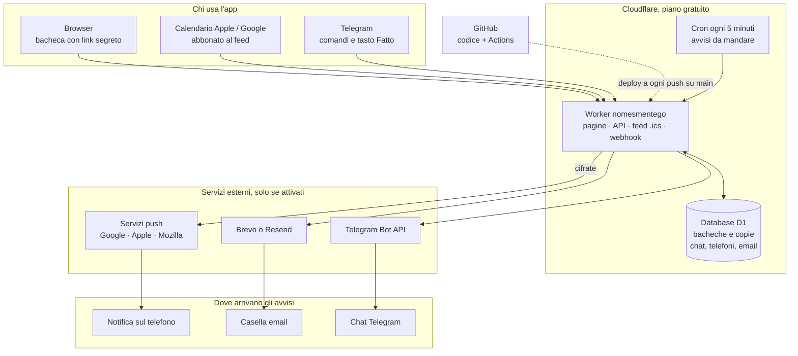

# Nomesmentego

I promemoria periodici di famiglia e amici in una web app semplice: spazzatura porta a porta, mercato del martedì,
scadenze dell'auto, medicine, compleanni. Si configura dal browser e gli avvisi arrivano **sul calendario del telefono**
(iPhone e Android), senza installare niente e senza account.

- Ogni **bacheca** (es. "Casa di mamma") ha un **link segreto**: chi lo apre la vede e la modifica dal browser.
  C'è anche un link di **sola lettura**.
- Promemoria **una volta**, **ogni giorno**, **ogni settimana**, **a settimane alterne / a rotazione** (con le voci,
  es. i tipi di rifiuto), **ogni mese**, **ogni anno** (o ogni N anni), con i preavvisi che vuoi.
- Qualunque promemoria può essere segnato come **scadenza**: passata la data ricorda ogni giorno (o ogni N giorni)
  finché qualcuno non preme **Fatto** (in *Oggi › I prossimi promemoria*, dove le scadenze hanno la scritta rossa,
  o dal messaggio Telegram).
- **Calendario in abbonamento**: un tocco per aggiungerlo a Calendario di iPhone o Google Calendar; le modifiche
  si aggiornano da sole.
- **Notifiche dell'app**: gli avvisi arrivano come notifiche sul telefono, senza installare niente
  (Android con Chrome; su iPhone dall'icona sulla schermata Home, iOS 16.4 o successivo).
- **Email**: un elenco di indirizzi per bacheca, con oggetto e testo personalizzabili; ogni indirizzo conferma
  con un clic prima di ricevere e può disiscriversi da ogni email.
- **Avvisi su Telegram**: un bot manda i promemoria in chat (anche in un gruppo di famiglia), all'ora di ogni avviso,
  con il tasto **Fatto** per le scadenze; per ogni chat si scelgono i gruppi da ricevere (es. la Passat a tre persone,
  la Puma a una sola).
- **Schema stampabile** delle prossime settimane, **copie di sicurezza** automatiche, import della vecchia app
  "Raccolta rifiuti" e del foglio dell'auto (vedi [`docs/esempi/auto-famiglia.yaml`](docs/esempi/auto-famiglia.yaml)).

La proposta di partenza e le scelte fatte sono in [`docs/PROPOSTA.md`](docs/PROPOSTA.md).

## Come funziona Cloudflare (in breve)

Cloudflare offre un piano **gratuito** per far girare piccoli programmi "in cloud" senza gestire un server:

- un **Worker** è il programma che risponde quando qualcuno apre l'indirizzo dell'app
  (qui: serve le pagine, salva le bacheche e genera il calendario);
- **D1** è il database dove stanno le bacheche;
- l'app riceve un indirizzo del tipo `https://nomesmentego.<tuo-nome>.workers.dev`.

Non c'è niente da accendere, aggiornare o tenere acceso: Cloudflare lo fa partire solo quando serve.
Per una famiglia i limiti gratuiti (oggi circa 100.000 richieste al giorno per i Worker e alcuni GB per D1)
sono ampiamente sufficienti; i valori aggiornati sono su
[Workers pricing](https://developers.cloudflare.com/workers/platform/pricing/) e
[D1 pricing](https://developers.cloudflare.com/d1/platform/pricing/).
Il codice è pubblicato in automatico da GitHub a ogni modifica del branch `main`.

## Dove sono i dati e chi li vede



**Non ci sono file di testo**: ogni bacheca è una riga nel database **D1** di Cloudflare (`nomesmentego`),
sul tuo account. Il telefono non è il "proprietario" dei dati, è solo una finestra sul server.

| Tabella | Cosa contiene |
|---|---|
| `bacheche` | una riga per bacheca: tutti i promemoria in una colonna `dati` (JSON), versione, date, link di sola lettura e **impronta** del link di modifica (SHA-256: dal database non si risale al link) |
| `storico` | copie di sicurezza automatiche: al massimo una ogni 10 minuti, le ultime 30 per bacheca |
| `telegram_iscrizioni`, `telegram_codici` | chat Telegram collegate (id della chat e nome) e codici usa-e-getta per collegarle |
| `notifiche` | telefoni con le notifiche dell'app (indirizzo del servizio push e chiavi) e indirizzi email, con il loro stato (da confermare / attivo) |
| `impostazioni` | chiavi VAPID per le notifiche (create al primo uso) e modelli delle email per bacheca |

Le tabelle sono definite in [`migrations/`](migrations). Si possono sfogliare dal pannello Cloudflare
(*Storage & Databases › D1 › nomesmentego*), dove si possono anche fare query SQL. Solo chi ha accesso
all'account Cloudflare vede il database.

**Sul telefono** (memoria del browser, `localStorage`) restano solo:
- l'elenco *Le tue bacheche* della pagina iniziale, cioè le scorciatoie alle bacheche **aperte su quel
  dispositivo**: un altro telefono non lo vede, e *Togli* rimuove solo la scorciatoia, non la bacheca;
- una copia dell'ultima versione di ogni bacheca aperta, per poterla guardare anche senza rete.

**Chi può fare cosa**
- Con il **link di modifica** (`/b/…`) si vede e si cambia la bacheca **da qualsiasi dispositivo**.
- Con il **link di sola lettura** (`/v/…`) la si vede, si riceve il calendario e ci si iscrive alle
  notifiche, ma non si modifica niente.
- Senza link non si arriva a nessuna bacheca: non esiste un elenco pubblico e il server non ha un
  comando per cancellarle.
- Per **crearne** una nuova serve il codice di invito (`CODICE_INVITO`), se impostato.
- Se un link finisce nelle mani sbagliate: *Notifiche e condivisione › Cambia i link*. Quello vecchio
  smette subito di funzionare.

**Copie e cancellazione**
- *Notifiche e condivisione › Copie di sicurezza*: ripristino di una versione precedente, oppure
  *Scarica una copia* (file `.json`, reimportabile con *Importa da file*).
- Per eliminare davvero una bacheca oggi si passa dalla console D1:
  `DELETE FROM bacheche WHERE id = '…'`. Le righe collegate (storico, Telegram, notifiche, email) si
  cancellano con lei; il modello delle email resta in `impostazioni` con chiave `email-modello:<id>`.

**Servizi esterni che vedono il contenuto degli avvisi** (solo se usati)
- **Calendario in abbonamento**: Google o Apple scaricano il feed `/feed/<link di sola lettura>.ics`.
- **Telegram**: i messaggi passano dai server di Telegram.
- **Email**: i messaggi passano da Brevo (o Resend).
- **Notifiche dell'app**: passano dal servizio push del browser (Google, Apple, Mozilla…), ma sono
  cifrate per il singolo telefono e il servizio non può leggerle.

## Messa in linea (una volta sola, ~15 minuti)

1. **Account Cloudflare** gratuito su <https://dash.cloudflare.com/sign-up>. Apri una volta
   *Workers & Pages* e scegli il sottodominio `workers.dev` che ti propone.
2. **Token per GitHub**: *My Profile › API Tokens › Create Token*, modello **Edit Cloudflare Workers**,
   poi aggiungi il permesso *Account › D1 › Edit*. Copia il token.
3. **ID dell'account**: in *Workers & Pages* è nella colonna di destra (*Account ID*).
4. **Segreti su GitHub**: nel repository *Settings › Secrets and variables › Actions › New repository secret*:
   - `CLOUDFLARE_API_TOKEN` = il token del punto 2
   - `CLOUDFLARE_ACCOUNT_ID` = l'ID del punto 3
   - `CODICE_INVITO` (facoltativo ma consigliato) = una parola da chiedere a chi crea una nuova bacheca,
     così solo chi la conosce può usare il tuo spazio.
5. Fai il merge su `main` (o lancia a mano *Actions › Test e pubblicazione › Run workflow*).
   La prima volta il workflow crea anche il database. L'indirizzo dell'app compare nella pagina
   dell'esecuzione (*Actions* › l'ultima esecuzione: riquadro **App pubblicata** e link sul job *deploy*)
   e nella colonna di destra della pagina del repository, sotto **Deployments › produzione**.

Poi apri l'indirizzo, crea la bacheca, aggiungi i promemoria e, nella scheda **Notifiche e condivisione**:
aggiungi il calendario al telefono e manda il link a chi serve.

## Notifiche dell'app (niente da configurare)

Nella scheda **Notifiche e condivisione › Notifiche dell'app** tocca **Attiva le notifiche su questo telefono** e
rispondi **Consenti**. Funziona anche con il link di sola lettura, quindi chiunque abbia la bacheca può attivarle
sul proprio telefono.
- **Android**: con Chrome (o Edge, Samsung Internet, Firefox) direttamente dal browser.
- **iPhone/iPad**: solo dall'icona sulla schermata Home (Safari › Condividi › Aggiungi alla schermata Home),
  con iOS 16.4 o successivo. L'app lo spiega da sola quando serve.

Le chiavi di sicurezza (VAPID) le crea il server al primo uso e le salva nel database. Se un telefono revoca il
permesso, viene tolto da solo.

## Email (facoltativo, ~10 minuti)

Per mandare email serve un servizio di invio. Consiglio **[Brevo](https://www.brevo.com)**: è gratuito fino a
300 email al giorno e non richiede un dominio.
1. Crea un account Brevo. In *Senders, Domains & Dedicated IPs › Senders* aggiungi l'indirizzo da cui partono le
   email (anche il tuo Gmail) e confermalo dal link che ricevi.
2. In *SMTP & API › API Keys* crea una chiave API.
3. Su GitHub aggiungi i segreti `BREVO_API_KEY` (la chiave) ed `EMAIL_MITTENTE` (l'indirizzo verificato).
   È facoltativo `EMAIL_NOME`, il nome che compare come mittente (es. "Promemoria di famiglia").
4. Rilancia il workflow. Il passo **Email** carica i segreti su Cloudflare.

In alternativa a Brevo puoi usare [Resend](https://resend.com) con `RESEND_API_KEY`: in quel caso serve un
dominio verificato per scrivere a indirizzi diversi dal tuo.

Nell'app, in **Notifiche e condivisione › Mail**:
- aggiungi gli indirizzi: ognuno riceve un'email di conferma e solo dopo il clic riceve i promemoria;
- scegli per ognuno quali gruppi riceve;
- in *Oggetto e testo dell'email* personalizzi i messaggi con parole che si riempiono da sole: `{testo}`,
  `{promemoria}`, `{voci}`, `{gruppo}`, `{data}`, `{quando}`, `{ripetizione}`, `{nota}`, `{bacheca}`.

In fondo a ogni email c'è sempre il link alla bacheca e quello per non riceverle più. Se usi un indirizzo Gmail
come mittente, le prime email possono finire nello spam: segnale come "non spam".

## Avvisi su Telegram (facoltativo, ~5 minuti)

1. Su Telegram apri **@BotFather**, scrivi `/newbot`, scegli un nome (es. "Promemoria di famiglia") e un nome
   utente che finisca in `bot` (es. `nomesmentego_carlo_bot`). BotFather ti risponde con un **token**
   del tipo `123456:ABC-...`: è la chiave del bot, non condividerla.
2. Su GitHub aggiungi il segreto `TELEGRAM_BOT_TOKEN` con quel token (come al punto 4 sopra).
3. Rilancia il workflow (*Actions › Test e pubblicazione › Run workflow*). Il passo **Bot Telegram** carica il token
   su Cloudflare, registra il webhook e i comandi del bot; nel riepilogo compare il nome del bot.
4. Nell'app, scheda **Notifiche e condivisione › Telegram**: **Collega la mia chat Telegram** apre il bot,
   tocca **Avvia** e torna nell'app. Per un gruppo: **Collega un gruppo Telegram** e scegli il gruppo.

Come funziona: ogni 5 minuti un *Cron Trigger* del Worker calcola gli avvisi scattati dall'ultimo giro (nell'ora
locale della bacheca) e li manda alle chat collegate. Lo stesso giro manda le notifiche dell'app e le email. Il tasto **Fatto** compare solo nelle chat collegate da chi
ha il link di modifica. Se una chat blocca il bot o lo toglie dal gruppo, viene scollegata da sola.
Comandi del bot: `/oggi` (cosa c'è oggi) e `/stop` (smetti di ricevere).

## Sviluppo in locale

Serve Node.js 20 o successivo.

```bash
npm install
npm test        # test del motore delle date, del calendario e del server
npm run dev     # crea il database locale e apre l'app su http://localhost:8787
```

Per provare il codice di invito in locale crea un file `.dev.vars` con `CODICE_INVITO=prova`.

## Struttura

```
web/                 l'app, servita così com'è (niente build)
  core/              motore condiviso tra app e server: niente DOM, niente rete
    date.js            date "AAAA-MM-GG" calcolate in UTC
    modello.js         formato della bacheca, normalizzazione, import della vecchia app
    motore.js          regole di ripetizione → occorrenze → avvisi; "Fatto"; frasi in italiano
    ics.js             calendario iCalendar per il feed e il file .ics
    modelli.js         modelli pronti (spazzatura, auto, compleanno, medicina, personalizzato)
  js/                interfaccia (moduli ES, senza framework)
    app.js             avvio, navigazione (#oggi, #promemoria, …), eventi
    stato.js           stato, salvataggio automatico e conflitti
    viste.js           schermate
    editor.js          editor guidato di un promemoria
  css/app.css        stile chiaro/scuro + stampa
worker/              Cloudflare Worker: API, feed /feed/<token>.ics, manifest per la schermata Home
  giro.js              parti comuni dei canali: quali avvisi mandare a chi dall'ultimo giro
  telegram.js          bot Telegram: collegamento delle chat, comandi, tasto "Fatto", invio periodico
  push.js              notifiche dell'app: cifratura RFC 8291, firma VAPID, abbonamenti
  email.js             email: Brevo/Resend, conferma e disiscrizione, modello del messaggio
web/sw.js            service worker: riceve le notifiche e apre la bacheca
migrations/          tabelle del database D1
test/                node --test
docs/                proposta ed esempi
prototipo/           la vecchia app "Raccolta rifiuti" da cui siamo partiti
```

### API

| Metodo | Percorso | Cosa fa |
|---|---|---|
| `POST` | `/api/bacheche` | crea una bacheca (`{nome, codice?, dati?}`) → link di modifica e di lettura |
| `GET` | `/api/b/<token>` | legge la bacheca; `permesso` è `modifica` o `lettura` |
| `PUT` | `/api/b/<token>` | salva `{versione, dati}`; `409` se nel frattempo qualcuno l'ha cambiata |
| `GET` | `/api/b/<token>/storico[/<versione>]` | copie di sicurezza |
| `POST` | `/api/b/<token>/rigenera` | cambia il link di `modifica` o di `lettura` |
| `GET` | `/feed/<token-lettura>.ics` | calendario in abbonamento (da 7 giorni fa a 13 mesi avanti) |
| `GET` | `/api/b/<token>/telegram` | stato del bot e chat collegate (solo chi può modificare) |
| `POST` | `/api/b/<token>/telegram/collega` | codice usa-e-getta (vale un'ora) → link `t.me/<bot>?start=…` |
| `PUT`/`DELETE` | `/api/b/<token>/telegram/<chat>` | gruppi ricevuti dalla chat (`{filtro}`), oppure scollega |
| `POST` | `/api/b/<token>/telegram/prova` | messaggio di prova a tutte le chat |
| `GET` | `/api/b/<token>/push/chiave` | chiave pubblica VAPID (creata al primo uso) |
| `POST` | `/api/b/<token>/push[/mio\|/via\|/prova]` | abbona questo telefono (`{abbonamento, nome}`), controlla, toglie, prova |
| `GET`/`PUT`/`DELETE` | `/api/b/<token>/push[/<id>]` | telefoni abbonati e loro filtro (solo chi può modificare) |
| `GET`/`POST` | `/api/b/<token>/email` | destinatari e modello; aggiungi un indirizzo (manda la conferma) |
| `PUT` | `/api/b/<token>/email/modello` | oggetto e testo (`{oggetto, corpo}` con i segnaposto) |
| `POST` | `/api/b/<token>/email/anteprima\|prova` | anteprima con dati d'esempio; email di prova agli indirizzi confermati |
| `GET`/`POST` | `/email/conferma/<token>`, `/email/stop/<token>` | pagine per confermare o disiscriversi (serve il pulsante) |
| `POST` | `/telegram/webhook` | aggiornamenti da Telegram (verificati con il segreto derivato dal token) |

Il link di modifica è salvato nel database solo come impronta SHA-256 (vedi *Dove sono i dati e chi li vede*).
Il server normalizza ogni bacheca con lo stesso codice dell'app (`web/core/modello.js`), quindi non accetta
dati malformati.


## Prossimi passi

Idee: tasto "Fatto" anche nelle notifiche dell'app e nelle email, riepilogo settimanale via email,
calendari comunali della raccolta rifiuti già pronti.

TODO: 
1. Nella sezione della scelta del quando succede (sezione 2 del setup promemoria) quando seleziono Ogni mese devo poter scegliere non solo Un giorno fisso ma n giorni fissi. Sostituisci quindi la dicitura e togli l'esempio mettendo "giorni fissi" (contemplando il caso che i mesi si fermano al 28 al minimo e quindi se viene selezionato un giorno fisso da 29 a 31 deve essere proposto all'utente di aggiungere il giorno fisso chiamato Fine mese che è sempre l'ultimo giorno del mese e si adatta dinamicamente alla lunghezza dei mesi. Comunque l'utente può scegliere di fregarsene dell'avviso e andare avanti e lasciare dei mesi in cui non riceverà l'avviso se sceglie ad es. 31 (quindi i mesi con 30 giorni non avranno quel giorno di avviso).
Inoltre Una volta va sostituito da Giorni specifici in cui posso scegliere delle date specifiche (posso sempre aggiungere dei giorni, non limitare la scelta in numero, es 20711/26, 13/3/27,...)

Nelle settimane a rotazione invece metti piuttosto la dicitura Settimane con voci. nel sottotesto "Per esempio la raccolta porta a porta: settimana A e settimana B che si alternano. Se ti serve, aggiungi voci (i tipi di rifiuto) e scegli quali passano ogni giorno." metti invece "Per esempio: 2 settimane che si alternano, settimana A e settimana B. Se ti serve, aggiungi voci (per differenziare gli avvisi) e scegli quali voci associare ai giorni. Se vuoi una settimane con voci basta togliere una settimana.

2. Nella sezione 3 Quando avvisarti, togli i preset già fatti nei rettangolini (La sera prima alle 20, la mattina alle 8, ...) e lascia solo la sezione in cui l'utente sceglie da solo quanto prima e a che ora impostando come default il giorno stesso alle 08:00. Devi però aggiungere la possibilità di associare al promemoria più avvisi in modo che l'utente possa ad es. scegliere: il giorno stesso alle 08:00 e anche la sera prima alle 21:00 ad esempio. Specifica nel sottotesto della sezione: in breve aggiungi a quello già presente "Ogni avviso diventa un promemoria sul calendario del telefono, all'ora che scegli." la frase "Puoi impostare anche più orari diversi." Modifica inoltre nel testo tra parentesi di Testo dell'avviso: scrivi "(facoltativo: se vuoto uso il nome del promemoria puoi usare le voci definite per questo promemoria)." e fai un es. di testo con embeddata un paio voci di medicine.

3. cambia il nome della sezione Schema in Specchietto. aggiungi la possibilità di vedere le settimane come già presente ma anche di poter switchare al mese e dai la possibilità di vedere fino a 2 mesi di calendario (il corrente e il successivo). Inoltre pensa a un una soluzione per vedere comunque bene i promemoria se un giorno è pieno che eviti brutti text wrap nelle caselle promemoria per quel giorno. Non so inventa qualcosa tu 

